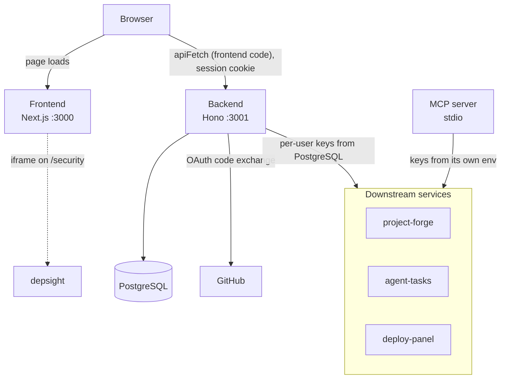
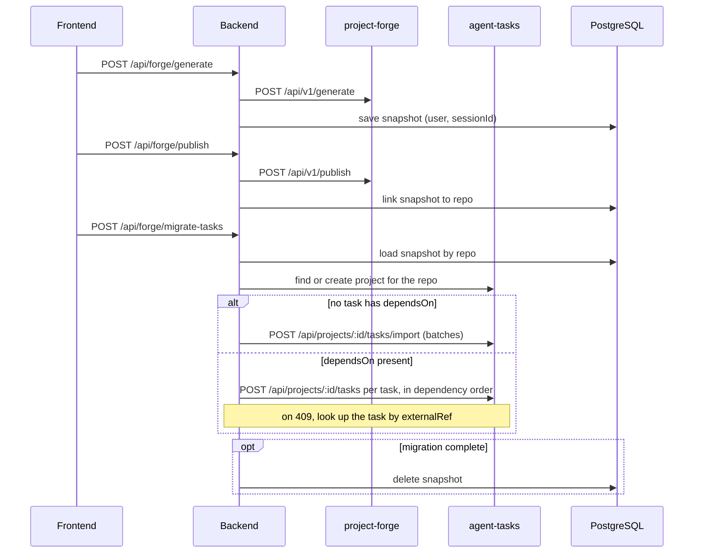

# Architecture

project-pilot is the unified control plane that aggregates three independent services into a single dashboard, single login, and single MCP surface.

It is one part of a wider toolchain. For the system-level view (shared design principles, how the tools connect, integration points), see [ecosystem.md](ecosystem.md).

```
project-pilot/
├── backend/     Hono API (port 3001)
├── frontend/    Next.js 15 (port 3000)
└── mcp/         MCP server (stdio)
```

## Aggregation model

project-pilot keeps business logic in the three services. The backend owns only user accounts and sessions, GitHub sign-in that registers the user with each service, encrypted service credentials, and forge task snapshots used to hand generated tasks to agent-tasks. All other calls are forwarded.

- **Backend** authenticates users (email/password or GitHub, see [GitHub sign-in](configuration.md#github-sign-in)), stores encrypted service credentials, keeps forge task snapshots for migration, and forwards requests (including the relay-install SSE stream) to downstream APIs.
- **Frontend** provides a unified dark-mode UI across all services.
- **MCP** exposes 18 tools for AI agent integration over stdio.

The MCP server is a separate client of the three services and uses keys from its own environment, not the credentials stored in the backend.

The component map below shows the browser loading pages from the frontend and calling the backend directly, the separate MCP path, the database and the external dependencies. The auth header each service expects is listed under [Downstream services](#downstream-services).



## Create to Develop handoff

Generating a project in `/forge/create` saves the preview's tasks as a `ForgeTaskSnapshot` keyed by user and forge session, and publishing binds that snapshot to the GitHub repo. **Migrate tasks** on `/forge` then loads the snapshot by repo, finds or creates the agent-tasks project for that repo, and imports the tasks. Re-runs are idempotent through each task's `externalRef`, and the snapshot is deleted only when the migration completed: it is kept when a task failed or when an already existing task's `dependsOn` edges could not be applied.

The sequence below shows the snapshot lifecycle and the two import paths.



## Module map

- `backend/src/routes/`: one Hono router per API area (`auth`, `oauth`, `credentials`, `dashboard`, `forge`, `tasks`, `deploy`, `health`), mounted in `backend/src/app.ts`.
- `backend/src/services/`: `auth`, `credentials`, `downstream`, `agent-tasks-client`, `github-oauth`, `module-registration`, `forge-task-snapshot`, `forge-task-migration`.
- `backend/src/middleware/`: `auth` (session check), `csrf`, `cors`, `rate-limit`, `security` (response headers).
- `backend/src/lib/`: `crypto` (credential encryption), `prisma` (client), `upstream-timeout`, `validate` (`zValidate`, `urlString`).

## Data model

The Prisma schema (`backend/prisma/schema.prisma`) is applied with `prisma db push`; the repository has no migrations directory. The backend image does not apply it on start: production applies it in the relay `post_update` step, the development compose stack in its `migrate` service.

- `User`: a local email/password account, a GitHub identity, or both.
- `Session`: hashed session token, valid for 30 days.
- `PasswordReset`: hashed reset token, valid for 1 hour.
- `ServiceCredential`: encrypted token per user and service.
- `ForgeTaskSnapshot`: forge preview tasks, kept until they are migrated into agent-tasks.

## Downstream services

| Service | Purpose | Auth |
|---------|---------|------|
| [project-forge](https://github.com/LanNguyenSi/project-forge) | AI-powered project scaffolding | `X-API-Key` |
| [agent-tasks](https://github.com/LanNguyenSi/agent-tasks) | Task management for human-agent collaboration | `Bearer` token |
| [deploy-panel](https://github.com/LanNguyenSi/deploy-panel) | VPS deployment management | `Bearer` API key |

## Tech stack

- **Frontend:** Next.js 15, React 19, Tailwind CSS
- **Backend:** Hono 4, TypeScript (strict), Prisma 5, PostgreSQL 16
- **MCP:** @modelcontextprotocol/sdk 1.32
- **Deployment:** Docker, Traefik

## MCP surface

The MCP server provides 18 tools for Claude Code and other MCP clients, grouped by domain.

**Forge:** `forge_list_projects`, `forge_create_project`, `forge_publish_project`

**Tasks:** `tasks_list_projects`, `tasks_list_tasks`, `tasks_claimable`, `tasks_get_instructions`, `tasks_claim`, `tasks_transition`, `tasks_create`

**Deploy:** `deploy_list_servers`, `deploy_list_apps`, `deploy_app`, `deploy_status`, `deploy_preflight`, `deploy_rollback`, `deploy_history`

**Aggregation:** `dashboard_summary`

See [configuration.md](configuration.md) for env vars and [api.md](api.md) for the HTTP surface.

## Pages

| Route | Description |
|-------|-------------|
| `/` | Landing page |
| `/login` | Login / Register |
| `/dashboard` | Aggregated overview |
| `/settings` | Service credential management |
| `/forge` | Project list |
| `/forge/create` | Create project wizard |
| `/tasks` | agent-tasks project list, create project, sync a team's GitHub repos |
| `/tasks/[projectId]` | Per-project task list & board |
| `/tasks/[projectId]/create` | Create task form |
| `/deploys` | Server fleet & deploy management |
| `/security` | Depsight CVE / repo health view |
| `/forgot-password` | Password reset request form |
| `/reset-password` | Set new password with token |
| `/auth/error` | OAuth sign-in error landing page |
| `/styleguide` | UI primitives showcase outside auth group, no login |
