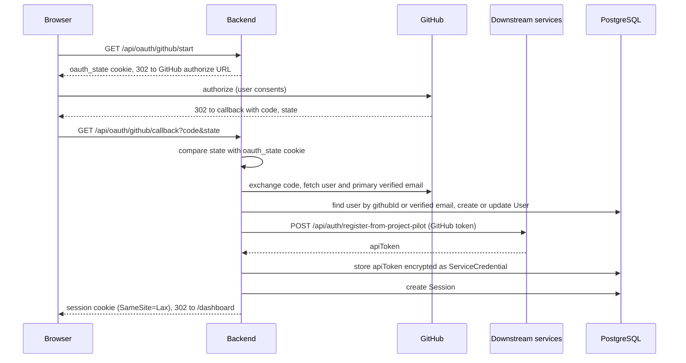

# Configuration

Credential storage, env vars, password reset.

## Credential storage

Service credentials (Forge API key, Tasks token, Deploy API key) are stored encrypted in PostgreSQL via the backend, scoped to the logged-in user. The encryption key is derived from `SESSION_SECRET`. The Settings page (`/settings`) saves each credential and then offers a **Test** action that calls the downstream service with the saved token.

The MCP server is a separate process and reads credentials from environment variables, not from the encrypted store.

## Backend (`backend/.env`)

| Variable | Required | Default | Description |
|----------|----------|---------|-------------|
| `DATABASE_URL` | yes |  | PostgreSQL connection string |
| `SESSION_SECRET` | yes |  | Secret from which the backend derives the AES-256-GCM key that encrypts stored service credentials (min 16 chars). Sessions do not use it. Changing it makes every stored credential unreadable: users must re-enter them in `/settings`, and until then requests that use a stored credential fail with 409 (`credential_unreadable`, "Re-enter it in /settings"); **Test** reports the same message. To end sessions, delete rows from the `Session` table instead. |
| `PORT` | no | 3001 | Backend port |
| `CORS_ORIGINS` | no | http://localhost:3000 | Allowed origins |
| `FRONTEND_URL` | no | http://localhost:3000 | Frontend URL |
| `NODE_ENV` | no | development | development, production, test |
| `PROJECT_FORGE_URL` | no | https://project-forge.opentriologue.ai | Forge API base URL |
| `AGENT_TASKS_URL` | no | https://agent-tasks.opentriologue.ai | Tasks API base URL |
| `DEPLOY_PANEL_URL` | no | https://deploy-panel.opentriologue.ai | Deploy API base URL |
| `BACKEND_URL` | no | http://localhost:3001 | Public backend URL, used to build the OAuth redirect URI |
| `GITHUB_CLIENT_ID` | no |  | GitHub OAuth app client ID. When unset (along with `GITHUB_CLIENT_SECRET`), the `/api/oauth/github/*` routes return 503. Enabling it forwards users' GitHub tokens to the three service URLs, see [GitHub sign-in](#github-sign-in) |
| `GITHUB_CLIENT_SECRET` | no |  | GitHub OAuth app client secret. When unset (along with `GITHUB_CLIENT_ID`), the `/api/oauth/github/*` routes return 503. Enabling it forwards users' GitHub tokens to the three service URLs, see [GitHub sign-in](#github-sign-in) |

## GitHub sign-in

When `GITHUB_CLIENT_ID` and `GITHUB_CLIENT_SECRET` are both set, the login page's **Continue with GitHub** button signs users in through a GitHub OAuth App, and the backend registers each user with the three downstream services.

- Register `<BACKEND_URL>/api/oauth/github/callback` as the OAuth App's callback URL.
- The requested scopes are `read:user user:email read:org repo workflow`. `repo` lets the downstream services read the user's repositories; `workflow` lets project-forge push scaffolds that contain `.github/workflows`.
- After sign-in, the backend sends the user's GitHub access token once to `POST /api/auth/register-from-project-pilot` on `PROJECT_FORGE_URL`, `AGENT_TASKS_URL` and `DEPLOY_PANEL_URL`. It stores each returned API token as that user's encrypted credential (labelled `GitHub: <login>`) and does not keep the GitHub token.
- Point these three variables at instances you trust before you set `GITHUB_CLIENT_ID` and `GITHUB_CLIENT_SECRET`, because their defaults are the hosted instances listed in the table above.
- If a service fails to register the user, sign-in still succeeds, and that service's credential can be pasted in `/settings`.
- An existing email/password account with the same verified email is not merged, and neither is an account already linked to a different GitHub user. The user lands on `/auth/error?reason=email_collision`.
- The session cookie from GitHub sign-in is `SameSite=Lax`; password login sets a `SameSite=Strict` cookie.

The sequence below shows one GitHub sign-in, from the login button to the dashboard redirect.



## Frontend (`frontend/.env`)

| Variable | Default | Description |
|----------|---------|-------------|
| `NEXT_PUBLIC_API_URL` | http://localhost:3001 | Backend URL for browser requests |
| `NEXT_PUBLIC_DEPSIGHT_URL` | https://depsight.opentriologue.ai | Depsight URL used by the Security page (`/security`) |

Both values are fixed when the frontend is built (Next.js inlines `NEXT_PUBLIC_*` into the client bundle); after changing them, rebuild the frontend image (or restart the dev server). `NEXT_PUBLIC_DEPSIGHT_URL` is also the only extra origin allowed in the CSP `frame-src`.

## MCP server

| Variable | Required | Description |
|----------|----------|-------------|
| `FORGE_API_KEY` | yes | project-forge API key (`pf_...`) |
| `TASKS_TOKEN` | yes | agent-tasks Bearer token |
| `DEPLOY_API_KEY` | yes | deploy-panel API key (`dp_...`) |
| `FORGE_URL` | no | Override Forge API URL |
| `TASKS_URL` | no | Override Tasks API URL |
| `DEPLOY_URL` | no | Override Deploy API URL |

## Password reset

The auth surface ships a forgot-password / reset-with-token flow via:

- `POST /api/auth/forgot-password` issues a reset token.
- `POST /api/auth/reset-password` consumes the token to set a new password.

Email delivery for the reset link is on the roadmap, not yet wired. Only the SHA-256 hash of the reset token is stored (`PasswordReset` table) and the token itself is discarded, so it cannot be read back from the database. `POST /api/auth/forgot-password` always responds with `{ "ok": true }`. Until email delivery exists, an operator can recover an account by inserting a `PasswordReset` row with a new UUID `id`, the user's `userId`, an `expiresAt` in the future and `tokenHash` set to the lowercase hex SHA-256 of a token they choose, then opening `/reset-password?token=<token>`. A successful reset ends all of that user's sessions.

## Security headers

The backend always emits `X-Content-Type-Options: nosniff`, `X-Frame-Options: DENY`, and `Referrer-Policy: strict-origin-when-cross-origin`, and adds `Strict-Transport-Security` in production (`NODE_ENV=production`). The frontend emits the `Content-Security-Policy` header on every response, regardless of `NODE_ENV`.

Session, CSRF, rate-limit and CORS rules for API requests are listed in [api.md](api.md#authentication-and-request-rules).

## Manual setup

If you don't want `make dev-full` and prefer to run the steps individually (replace `make docker-up` with your own PostgreSQL 16 on :5432 if you do not use Docker):

```bash
make install        # npm install at the root (workspaces: backend, frontend, mcp)
cp backend/.env.example backend/.env
cp frontend/.env.example frontend/.env

make docker-up      # start Postgres on :5432
make db-generate    # prisma generate
make db-push        # prisma db push (reads DATABASE_URL from backend/.env)

make dev            # backend on :3001, frontend on :3000
```

See the env var tables above for what each `.env` file needs.

Other Makefile targets:

| Target | What it does |
|--------|--------------|
| `make setup` | `make install` plus `prisma generate` |
| `make dev-backend` | Backend dev server only |
| `make dev-frontend` | Frontend dev server only |
| `make build` | Builds backend, frontend and mcp |
| `make clean` | Removes `backend/dist`, `frontend/.next` and `mcp/dist` |
| `make docker-down` | Stops the Docker Compose stack |
| `make deploy` | `git pull`, then the production compose command (see [Production](#production-with-traefik)) |

## Docker deployment

The backend container applies the database schema with `prisma db push` on start and discards that command's error output. If the backend starts but queries fail, run `npx prisma db push` inside the backend container and read its output.

### Development

```bash
docker compose up
```

### Production (with Traefik)

Prerequisites:

1. Set `POSTGRES_PASSWORD` and `SESSION_SECRET` (min 16 chars), and optionally `GITHUB_CLIENT_ID` and `GITHUB_CLIENT_SECRET`, in the shell or in a `.env` file next to `docker-compose.prod.yml`. The backend exits at start when `SESSION_SECRET` is missing or shorter than 16 chars. The file does not pass `PROJECT_FORGE_URL`, `AGENT_TASKS_URL` or `DEPLOY_PANEL_URL` to the backend, so their defaults apply unless you add them to the backend's `environment` (see [GitHub sign-in](#github-sign-in)).
2. Run Traefik attached to an external Docker network named `traefik`, with a certificate resolver named `letsencrypt`.
3. The hostname is set inside `docker-compose.prod.yml`: in the `Host()` router rules, `CORS_ORIGINS`, `FRONTEND_URL`, `BACKEND_URL` and the frontend `NEXT_PUBLIC_*` build args. To deploy under another domain, change all of them and rebuild the frontend image, because `NEXT_PUBLIC_*` values are fixed at build time.

```bash
docker compose -f docker-compose.prod.yml up --build -d
```

Exposes via Traefik at `project-pilot.opentriologue.ai` with automatic HTTPS. `make deploy` runs `git pull` and then this command.
