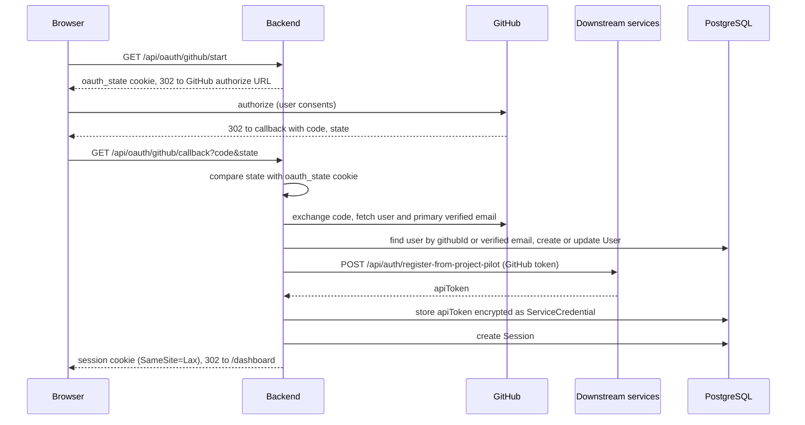

# Configuration

Credential storage, env vars, password reset.

## Credential storage

Service credentials (Forge API key, Tasks token, Deploy API key) are stored encrypted in PostgreSQL via the backend, scoped to the logged-in user. The encryption key is derived from `SESSION_SECRET`. The Settings page (`/settings`) saves each credential and then offers a **Test** action that calls the downstream service with the saved token.

The MCP server is a separate process and reads credentials from environment variables, not from the encrypted store.

## Backend (`backend/.env`)

| Variable | Required | Default | Description |
|----------|----------|---------|-------------|
| `DATABASE_URL` | yes |  | PostgreSQL connection string |
| `SESSION_SECRET` | yes |  | Secret from which the backend derives the AES-256-GCM key that encrypts stored service credentials (min 16 chars). With `NODE_ENV=production` a known placeholder value (the ones in `backend/.env.example` and `docker-compose.yml`) is rejected at start even though it clears the length rule; outside production a placeholder is accepted with a warning. Sessions do not use it. Changing it makes every stored credential unreadable: users must re-enter them in `/settings`, and until then requests that use a stored credential fail with 409 (`credential_unreadable`, "Re-enter it in /settings"); **Test** reports the same message. The dashboard does not fail as a whole: the affected service is marked **Credential unreadable** with a hint to re-enter it in Settings, and the other services still show their data. To end sessions, delete rows from the `Session` table instead. |
| `PORT` | no | 3001 | Backend port |
| `CORS_ORIGINS` | no | http://localhost:3000 | Allowed origins |
| `FRONTEND_URL` | no | http://localhost:3000 | Frontend URL |
| `NODE_ENV` | no | development | development, production, test |
| `PROJECT_FORGE_URL` | yes in production | https://project-forge.opentriologue.ai | Forge API base URL. Required with `NODE_ENV=production` (missing or empty fails startup); outside production it falls back to this default with a warning |
| `AGENT_TASKS_URL` | yes in production | https://agent-tasks.opentriologue.ai | Tasks API base URL. Required with `NODE_ENV=production` (missing or empty fails startup); outside production it falls back to this default with a warning |
| `DEPLOY_PANEL_URL` | yes in production | https://deploy-panel.opentriologue.ai | Deploy API base URL. Required with `NODE_ENV=production` (missing or empty fails startup); outside production it falls back to this default with a warning |
| `BACKEND_URL` | no | http://localhost:3001 | Public backend URL, used to build the OAuth redirect URI |
| `GITHUB_CLIENT_ID` | no |  | GitHub OAuth app client ID. When unset (along with `GITHUB_CLIENT_SECRET`), the `/api/oauth/github/*` routes return 503. Enabling it forwards users' GitHub tokens to the three service URLs, see [GitHub sign-in](#github-sign-in) |
| `GITHUB_CLIENT_SECRET` | no |  | GitHub OAuth app client secret. When unset (along with `GITHUB_CLIENT_ID`), the `/api/oauth/github/*` routes return 503. Enabling it forwards users' GitHub tokens to the three service URLs, see [GitHub sign-in](#github-sign-in) |

## GitHub sign-in

When `GITHUB_CLIENT_ID` and `GITHUB_CLIENT_SECRET` are both set, the login page's **Continue with GitHub** button signs users in through a GitHub OAuth App, and the backend registers each user with the three downstream services.

- Register `<BACKEND_URL>/api/oauth/github/callback` as the OAuth App's callback URL.
- The requested scopes are `read:user user:email read:org repo workflow`. `repo` lets the downstream services read the user's repositories; `workflow` lets project-forge push scaffolds that contain `.github/workflows`.
- After sign-in, the backend sends the user's GitHub access token once to `POST /api/auth/register-from-project-pilot` on `PROJECT_FORGE_URL`, `AGENT_TASKS_URL` and `DEPLOY_PANEL_URL`. It stores each returned API token as that user's encrypted credential (labelled `GitHub: <login>`) and does not keep the GitHub token.
- Point these three variables at instances you trust before you set `GITHUB_CLIENT_ID` and `GITHUB_CLIENT_SECRET`, because their defaults are the hosted instances listed in the table above. `PROJECT_FORGE_URL`, `AGENT_TASKS_URL` and `DEPLOY_PANEL_URL` are required with `NODE_ENV=production`: a missing or empty one stops the backend at start, so the defaults are never used in production.
- If a service fails to register the user, sign-in still succeeds, and that service's credential can be pasted in `/settings`.
- An existing email/password account with the same verified email is not merged, and neither is an account already linked to a different GitHub user. The user lands on `/auth/error?reason=email_collision`.
- The session cookie from GitHub sign-in is `SameSite=Lax`; password login sets a `SameSite=Strict` cookie.

The sequence below shows one GitHub sign-in, from the login button to the dashboard redirect.



## Frontend (`frontend/.env`)

| Variable | Default | Description |
|----------|---------|-------------|
| `NEXT_PUBLIC_API_URL` | http://localhost:3001 | Backend URL for browser requests |
| `NEXT_PUBLIC_DEPSIGHT_URL` | https://depsight.opentriologue.ai | Depsight URL used by the Security page (`/security`) |

Both values are fixed when the frontend is built (Next.js inlines `NEXT_PUBLIC_*` into the client bundle); after changing them, rebuild the frontend image (or restart the dev server). `NEXT_PUBLIC_DEPSIGHT_URL` is also the only extra origin allowed in the CSP `frame-src`.

## MCP server

| Variable | Required | Description |
|----------|----------|-------------|
| `FORGE_API_KEY` | yes | project-forge API key (`pf_...`) |
| `TASKS_TOKEN` | yes | agent-tasks Bearer token |
| `DEPLOY_API_KEY` | yes | deploy-panel API key (`dp_...`) |
| `FORGE_URL` | no | Override Forge API URL |
| `TASKS_URL` | no | Override Tasks API URL |
| `DEPLOY_URL` | no | Override Deploy API URL |

## Password reset

The auth surface ships a forgot-password / reset-with-token flow via:

- `POST /api/auth/forgot-password` issues a reset token.
- `POST /api/auth/reset-password` consumes the token to set a new password.

Email delivery for the reset link is on the roadmap, not yet wired. Only the SHA-256 hash of the reset token is stored (`PasswordReset` table) and the token itself is discarded, so it cannot be read back from the database. `POST /api/auth/forgot-password` always responds with `{ "ok": true }`. Until email delivery exists, an operator can recover an account by inserting a `PasswordReset` row with a new UUID `id`, the user's `userId`, an `expiresAt` in the future and `tokenHash` set to the lowercase hex SHA-256 of a token they choose, then opening `/reset-password?token=<token>`. A successful reset ends all of that user's sessions.

## Security headers

The backend always emits `X-Content-Type-Options: nosniff`, `X-Frame-Options: DENY`, and `Referrer-Policy: strict-origin-when-cross-origin`, and adds `Strict-Transport-Security` in production (`NODE_ENV=production`). The frontend emits the `Content-Security-Policy` header on every response, regardless of `NODE_ENV`: `next start` sends it and `next dev` sends it too (verified with Next.js 15: `next dev` applies the `headers()` from `frontend/next.config.ts`). Its `connect-src` allows `'self'` plus the origin of `NEXT_PUBLIC_API_URL`, the same value and default (`http://localhost:3001`) the browser calls in `frontend/src/lib/api.ts`, so the dev setup's cross-origin API calls pass; an unparseable `NEXT_PUBLIC_API_URL` adds nothing and leaves `connect-src` at `'self'` only. Like the other `NEXT_PUBLIC_*` values, that origin is fixed when the frontend is built, so changing it takes a rebuild (or a dev server restart, see [Frontend](#frontend-frontendenv)).

Session, CSRF, rate-limit and CORS rules for API requests are listed in [api.md](api.md#authentication-and-request-rules).

## Manual setup

If you don't want `make dev-full` and prefer to run the steps individually (replace `make docker-up` with your own PostgreSQL 16 on :5432 if you do not use Docker):

```bash
make install        # npm install at the root (workspaces: backend, frontend, mcp)
cp backend/.env.example backend/.env
cp frontend/.env.example frontend/.env

make docker-up      # start Postgres on :5432
make db-generate    # prisma generate
make db-push        # prisma db push (reads DATABASE_URL from backend/.env)

make dev            # backend on :3001, frontend on :3000
```

See the env var tables above for what each `.env` file needs.

Other Makefile targets:

| Target | What it does |
|--------|--------------|
| `make setup` | `make install` plus `prisma generate` |
| `make dev-backend` | Backend dev server only |
| `make dev-frontend` | Frontend dev server only |
| `make build` | Builds backend, frontend and mcp |
| `make clean` | Removes `backend/dist`, `frontend/.next` and `mcp/dist` |
| `make docker-down` | Stops the Docker Compose stack |
| `make deploy` | Manual fallback for the relay deploy: `git pull`, the production compose command (see [Production](#production-with-traefik)), `prisma db push` without a data-loss flag, then a bounded `/api/health` wait that exits non-zero on failure |
| `make backup` | Dumps the production database with `scripts/backup.sh` (see [Backup and restore](#backup-and-restore)) |
| `make restore` | `FILE=<dump> CONFIRM=yes [NO_PRE_BACKUP=yes]`: replaces the production database with a dump (destructive; see [Backup and restore](#backup-and-restore)) |

### Dev database volume and port

`docker-compose.yml` (the dev stack behind `make docker-up`) sets its own compose project name, `project-pilot-dev`, so its database volume is `project-pilot-dev_pgdata`. The production stack in `docker-compose.prod.yml` uses the checkout directory name as project name (`project-pilot` on the production host) and keeps its volume `project-pilot_pgdata`. The dev file also pins the volume's own name, so the dev database volume stays `project-pilot-dev_pgdata` even when `COMPOSE_PROJECT_NAME` is exported or set in the shared `.env`, or when `-p` is passed; running the dev file on the production host therefore starts a separate, empty database and never touches the production volume. Those overrides do change the project of the dev containers and network, though: `docker compose -f docker-compose.yml -p project-pilot ...` on the production host acts on the production containers (same project), so never pass `-p project-pilot` with the dev file. The same happens when the shared `.env` or the shell sets `COMPOSE_PROJECT_NAME=project-pilot`: then `make docker-up` replaces the production db container with the dev one (the production data stays in its volume, but production is down) and `make docker-down` removes the production containers. Never run the dev targets on the production host. CI renders both files (the dev side once as `-f docker-compose.yml` and once as a plain `docker compose` in the repo root, with every compose profile enabled) and fails if their effective pgdata volume names are equal, if any dev volume carries the production volume's name, or if a dev service uses `volumes_from`. The dev Postgres publishes only on `127.0.0.1:5432`, so other machines cannot reach it.

Upgrade note for developers: before this change the dev database lived in a volume named after your checkout directory (for example `project-pilot_pgdata`). The dev stack now starts with a fresh `project-pilot-dev_pgdata`. Either re-seed (`make docker-up`, then `make db-push`), or carry the old data over once. Everything below is for a developer machine only; never run it on the production host, where the old directory name is the production project. Stop the old dev database first (the new file targets `project-pilot-dev`, so a plain `docker compose down` would not stop it): find its container with `docker ps` and run `docker stop <old-db-container>`, or run `docker compose -p <old-directory-name> stop` using the OLD revision of `docker-compose.yml`. Then copy the old volume into the new one:

```bash
docker stop <old-db-container>
docker volume create project-pilot-dev_pgdata
docker run --rm -v <old-volume>:/from:ro -v project-pilot-dev_pgdata:/to alpine cp -a /from/. /to/
```

Replace `<old-volume>` with the old dev volume (`docker volume ls`). Only do this on a developer machine: on the production host the old name is the production volume, so skip the copy there, and never run `docker compose down -v` with `docker-compose.prod.yml`.

## Docker deployment

No deploy path passes a data-loss flag to Prisma, and exactly one step applies the schema in production. The backend image only starts the server (`node dist/server.js`); it runs no `prisma` command, so a container restart (crash, host reboot, `docker restart`) never touches the schema and two containers never push DDL at the same time. The one schema step is `prisma db push` without a data-loss flag:

- The relay deploy (`.relay.yml`) runs it as its `post_update` step, inside the running backend container, after `compose up -d` and before the `/api/health` check (the health route only runs `SELECT 1`, so it does not need the new tables). When the push fails the step fails, the deploy fails and agent-relay rolls back; read Prisma's error in the deploy output.
- `make deploy` is the manual fallback and runs the same sequence: `git pull`, `docker compose -f docker-compose.prod.yml up --build -d`, the push, then a wait of up to 60 seconds (`HEALTH_TRIES` x `HEALTH_INTERVAL`, default 30 x 2; both must be positive integers or the target exits with status 2 before pulling) for `/api/health` inside the backend container. It exits non-zero when the push fails or the backend does not become healthy.
- The development stack (`docker-compose.yml`) has a one-shot `migrate` service that runs the same push once per `docker compose up`, before the backend starts. Without it the image would start against an empty database.

Between `compose up -d` and the `post_update` push, the new backend container serves requests against the previous schema (a few seconds on a deploy that changes the schema).

A change that Prisma flags as data loss (dropping a column or table that still holds values, adding a UNIQUE constraint over duplicate values) makes the push exit non-zero, so the deploy fails and nothing is dropped. The database keeps its old schema and data; the deploy stays failed, and the rollback restores the previous commit, until the schema change is resolved or applied by hand.

To apply such a change deliberately, run the push once from a one-off container built from the new image. Do not use `exec` for this: after a relay failure, agent-relay rolls back (`git reset --hard` to the previous commit, rebuilds and restarts the old image), so a push exec'd into the running backend sees the old schema and does nothing; after a failed `make deploy` the running backend is the new image, but the schema is still old. `run --rm --no-deps` starts a fresh container from the image you just built, whichever commit the running container was built from. On the host:

1. Check out the new commit (`git pull`). After a relay failure the host tree and the backend are back at the previous commit, so the pull is needed; after a failed `make deploy` the tree is already at the new commit and the backend stays down until this procedure is done or the commit is reverted.
2. Build the new backend image: `docker compose -f docker-compose.prod.yml build backend`.
3. Back up the database with `make backup` (or `scripts/backup.sh`; see [Backup and restore](#backup-and-restore)) and continue only if it exits 0; it prints the path of the new dump, which you keep for a restore. The script writes outside the checkout (by default into `$HOME/project-pilot-backups`) and refuses a directory inside it: agent-relay refuses to deploy a tree with untracked files, so the redeploy in step 6 would fail, and a production dump does not belong next to the app source.
4. Optional, to avoid errors during the next step: stop the backend (`docker compose -f docker-compose.prod.yml stop backend`). Otherwise the backend that is still running (the previous commit after a relay failure) serves requests against the changed schema from step 5 until the redeploy in step 6 and fails on queries that touch the dropped column or table.
5. Apply the schema once, with the flag: `docker compose -f docker-compose.prod.yml run --rm --no-deps -e HOME=/tmp backend npx prisma db push --schema=prisma/schema.prisma --accept-data-loss` (the schema path is relative to the image's working directory, which holds `prisma/schema.prisma`; `--no-deps` leaves the running database container alone).
6. Redeploy as usual (relay or `make deploy`); the push now finds nothing to change.

Do not add the flag to `.relay.yml`, the Makefile, the compose files or the Dockerfile, and do not add a second schema step (a `prisma` call in the image `CMD` or in the production compose file).

### Development

```bash
docker compose up
```

The `migrate` service applies the schema (`prisma db push`) and exits before the backend starts; to re-apply it later without restarting the stack run `docker compose run --rm migrate`. The local, non-Docker flow keeps using `make db-push`.

### Production (with Traefik)

Prerequisites:

1. Set `POSTGRES_PASSWORD`, a real `SESSION_SECRET` (min 16 chars, not a known placeholder), and `PROJECT_FORGE_URL`, `AGENT_TASKS_URL` and `DEPLOY_PANEL_URL` in the shell or in a `.env` file next to `docker-compose.prod.yml`; optionally set `GITHUB_CLIENT_ID` and `GITHUB_CLIENT_SECRET`. The backend exits at start when `SESSION_SECRET` is missing, shorter than 16 chars, or a known placeholder, and `docker-compose.prod.yml` passes the three service URLs with `${NAME:?...}`, so compose itself fails until you set them (see [GitHub sign-in](#github-sign-in)).
2. Run Traefik attached to an external Docker network named `traefik`, with a certificate resolver named `letsencrypt`.
3. The hostname is set inside `docker-compose.prod.yml`: in the `Host()` router rules, `CORS_ORIGINS`, `FRONTEND_URL`, `BACKEND_URL` and the frontend `NEXT_PUBLIC_*` build args. To deploy under another domain, change all of them and rebuild the frontend image, because `NEXT_PUBLIC_*` values are fixed at build time.

```bash
docker compose -f docker-compose.prod.yml up --build -d
```

Exposes via Traefik at `project-pilot.opentriologue.ai` with automatic HTTPS. `make deploy` runs `git pull`, this command, the schema push and a health wait (see [Docker deployment](#docker-deployment)).

Every service in `docker-compose.prod.yml` rotates its json-file logs (`max-size: 10m`, `max-file: 3`, shared through the `x-logging` anchor) and sets a memory limit with `mem_limit` (db `1g`, backend `768m`, frontend `512m`), so a chatty or leaking container cannot fill the host disk or memory. `mem_limit` is the Compose spec key applied by plain `docker compose up -d` without swarm; `docker compose -f docker-compose.prod.yml config` shows it in the rendered config. The limits take effect when `up -d` recreates the containers; a container that reaches its limit is OOM-killed and comes back through `restart: unless-stopped`, so check `docker inspect --format '{{.State.OOMKilled}}' <container>` after a restart.

Both images build with the repository root as context and install dependencies with `npm ci` from the root `package-lock.json`, so run image builds from the repository root (`docker build -f backend/Dockerfile .`, `docker build -f frontend/Dockerfile .`).

### Backup and restore

The database in the volume `project-pilot_pgdata` holds the only state that cannot be rebuilt: users, sessions, password-reset tokens, the stored (encrypted) service credentials and the forge task snapshots. A deploy never backs it up and nothing in the compose files does it for you: **scheduling `scripts/backup.sh` on the host is the operator's job**, and a lost volume without a dump is a lost instance. The commands below are for the production stack in `docker-compose.prod.yml`, run in the checkout on the production host. They never act on the development stack (`docker-compose.yml`), and both scripts refuse to run with it: they refuse the checkout's `docker-compose.yml` however it is named (relative path, directory symlink, file symlink, hardlink); a separate copy of that file is not recognised.

**Backup.** `scripts/backup.sh` (or `make backup`) runs `pg_dump -Fc` (custom format, compressed) inside the `db` service through `docker compose exec -T`, so the host needs no Postgres client and the database stays on its private network. The dump goes to a hidden temp file first. Before it is published, `pg_restore` inside the `db` container reads the whole archive (`pg_restore -f /dev/null`): a truncated or corrupt custom-format archive fails that read, which `pg_restore --list` would not notice because it reads only the table of contents. Only then the file is renamed to `project-pilot-<YYYYMMDD_HHMMSS>.dump` (directory mode 700 when the script creates it, files 600; a second run in the same second gets a `-<pid>` suffix instead of overwriting). A failed run never leaves a truncated `.dump` behind. It refuses to start (exit 2) while the `db` service is not running in the compose file, so a cron job cannot report success for a stack that is down. Exit codes: 0 done, 1 dump failed or invalid, 2 refused (configuration, compose file, a directory inside the checkout, db not running), 3 dump kept but the off-host hook failed.

```bash
# crontab of the user that runs docker, daily at 03:17 (install it yourself; nothing does it for you)
17 3 * * * cd /path/to/project-pilot && scripts/backup.sh >> "$HOME/project-pilot-backup.log" 2>&1
```

Keep the log under the home directory of that user: a user in the `docker` group cannot create files in `/var/log`, and a cron redirect that cannot open its file means the script never runs, with no error anywhere you would look.

| Variable | Default | Meaning |
| --- | --- | --- |
| `BACKUP_COMPOSE_FILE` | `docker-compose.prod.yml` in the checkout | Compose file of the stack to back up (the checkout's `docker-compose.yml` is refused) |
| `BACKUP_DB_SERVICE` | `db` | Compose service that runs Postgres |
| `BACKUP_DIR` | `$HOME/project-pilot-backups` | Where dumps go. Set and non-empty wins; empty counts as unset. A directory inside the checkout is refused (see below) |
| `BACKUP_SKIP_ROTATION` | (unset) | Any value skips the rotation (`restore.sh` sets it for its pre-restore dump) |
| `PG_USER`, `PG_DB` | `project_pilot`, `project_pilot` | Database role and name |
| `KEEP_FILES` | `14` | Keep at most this many dumps |
| `KEEP_DAYS` | `14` | Delete dumps older than this many days |
| `BACKUP_OFFHOST_HOOK` | (unset) | Executable that copies a finished dump off the host |

**Where dumps live.** Outside the checkout, on purpose: agent-relay refuses to deploy a tree with untracked files, and both Dockerfiles build from the repository root, so a dump in the checkout would block the next deploy and be sent to the Docker daemon with every build. `backup.sh` therefore refuses (exit 2) any `BACKUP_DIR` that lies inside the checkout, after resolving symlinks and `..`. The default `$HOME/project-pilot-backups` belongs to the user that runs the job; point `BACKUP_DIR` at a dedicated directory or another disk if you prefer (for example `/var/backups/project-pilot` created for the cron user).

**Retention.** After a successful run the script keeps the newest `KEEP_FILES` dumps and deletes any older than `KEEP_DAYS` days; both rules apply, so the stricter one decides, and the dump it just wrote is never aged out. A run that fails (including a failed off-host hook) rotates nothing, so a broken run never pushes the last good dump out. A dump is about the size of the data: plan `KEEP_FILES` x dump size of disk.

**Off-host copy.** Dumps in `$HOME/project-pilot-backups` live on the same disk as the database, so a lost host loses the restore points too. Set `BACKUP_OFFHOST_HOOK` to the path of an executable; it is called once per successful dump with the dump path as its only argument, for example a script that runs `gpg --encrypt` and `rclone copy`. The script does not schedule or ship anything itself. A hook that is not an executable file stops the run before dumping (exit 2); a hook that fails makes the run exit 3 with the local dump kept.

**What a dump contains, and what it needs.** The dump holds the user rows (email, password hashes), the session and password-reset token hashes and the stored service credentials, which are encrypted with a key derived from `SESSION_SECRET`. Treat it like the database itself: keep it mode 600, and encrypt it in the off-host hook before it leaves the host. The dump does not contain `.env`: **a dump is useless without the `SESSION_SECRET` it was written under**, because a restore with another value leaves every stored credential unreadable (users have to enter them again). Back up the `.env` file next to `docker-compose.prod.yml` separately, with the same care.

**Restore.** `scripts/restore.sh --yes <dump>` (or `make restore FILE=<dump> CONFIRM=yes`) replaces the content of the running database with a dump. It is destructive: the whole `public` schema is dropped and recreated before the dump is loaded, so every table that is not in the dump is gone and rows written after the dump are lost. (Loading the dump over the existing tables is not enough: a table a newer release added with a foreign key into a dumped table would make the restore fail.) Without `--yes` it only says so, naming the compose file it would act on, and exits 2; without a file argument it never runs. There is no interactive prompt. In order it:

1. checks that `db` is running and converts the dump to SQL with `pg_restore -f -` inside the `db` container into a private temporary file. `pg_restore` reads the whole archive, so a truncated or corrupt file fails here, before anything is changed; the file is read once, so a file that is rotated away or truncated meanwhile cannot change what is loaded. The SQL must carry pg_dump's "dump complete" marker as a line of its own and no transaction control statements, and the temporary file is removed on every exit path;
2. **stops the `backend` service** (its open connections would block the `DROP`s and it would write rows meanwhile; `RESTORE_APP_SERVICE` names another service, an empty value leaves it alone);
3. takes a dump of the **current** state with `scripts/backup.sh` into `BACKUP_DIR` (rotation skipped, so it can never age out the file you are restoring), unless you pass `--no-pre-backup` (`NO_PRE_BACKUP=yes` for `make restore`). If that backup fails nothing has been changed: the backend is started again and the script exits 3. A nearly empty database is below the size floor of the validation and fails the same way; restore into it with `--no-pre-backup`;
4. feeds `BEGIN;`, `DROP SCHEMA public CASCADE`, the re-creation of the schema with the owner and grants of a fresh PostgreSQL 16 database, the SQL and, only when the whole SQL was read successfully, `COMMIT;` to `psql -v ON_ERROR_STOP=1`. `--single-transaction` is not used because it commits at the end of the input: an input that ends early would commit an empty schema. Any error, or input that cannot be read to the end, ends the session without a commit, so the database keeps its old content; the backend stays stopped;
5. re-applies the schema the way a deploy does: `docker compose -f docker-compose.prod.yml run --rm -T --no-deps -e HOME=/tmp backend npx prisma db push --schema=prisma/schema.prisma`, **without** `--accept-data-loss`, so a dump that predates a schema change gets the tables and columns the deployed code expects before any request arrives (`RESTORE_SCHEMA_SERVICE` names another service, an empty value skips the step);
6. starts the backend again, only after steps 4 and 5 succeeded.

Exit codes: 0 restored, 1 invalid dump, backend could not be stopped (nothing changed) or psql failed (rolled back), 2 refused, 3 the pre-restore backup failed (nothing changed), 4 the dump is restored but the schema step or the backend start failed (the message prints the command to run).

```bash
ls -t "$HOME"/project-pilot-backups/project-pilot-*.dump | head -3      # pick a dump
scripts/restore.sh --yes "$HOME/project-pilot-backups/project-pilot-20261027_031700.dump"
curl -fsS https://project-pilot.opentriologue.ai/api/health            # the backend answers again
```

The dump is the schema and the data of the moment it was taken. Restoring a dump taken from newer code than the deployed code is not supported: the schema step may refuse to drop what the older schema lacks (exit 4, backend left stopped). The dump does not carry roles: it assumes the `project_pilot` role of the same compose file exists, as it does on a stack created from it.

**Rollback does not restore data.** `rollback: true` in `.relay.yml` makes agent-relay reset the checkout to the previous commit and rebuild the containers after a failed deploy. That restores code only: the schema changes `prisma db push` applied and the rows the new code wrote stay in the volume. Only a restore from a dump takes the database back.

**Restore drill.** A backup that has never been restored is a hope. CI job `Restore drill (Postgres)` runs `scripts/restore-drill.sh` on the triggers of `ci.yml` (push and pull request to `main` and `develop`, plus `workflow_call`): it applies the schema with `prisma db push`, seeds users, a session and service credentials, runs the real `scripts/backup.sh`, restores that dump with the real `scripts/restore.sh` into a freshly created second database, and asserts the row counts, the content of one row and the unique constraint on the credentials. It then repeats the restore into that populated database after adding a table with a foreign key into a dumped table (what a newer release does) and a row written after the dump, and asserts that both are gone, that the pre-restore dump holds them, that the schema owner is the one of a fresh database and that `prisma db push` finds the restored schema in sync. A truncated dump and a SQL copy that disappears after the conversion must each leave the database unchanged, and a `pg_dump` that is cut short (inside the data, not only the table of contents) must not be published. The drill itself refuses to seed a container named `project-pilot-db` or a database that already holds users whose id does not start with `drill-`. The scripts see a `docker` shim that forwards their `docker compose exec -T db ...` calls to a scratch Postgres container, so every `pg_dump`, `pg_restore` and `psql` option the drill uses is the one in the scripts; if the options drift or the dump stops restoring, the job fails. The shim has no `backend` service, so stopping the backend, the schema step and the start are covered by the stub tests (`scripts/restore.test.sh`) only. Job `Backup scripts` runs `shellcheck` and the stub tests for both scripts. Run the drill by hand against a scratch container (never production) with `DRILL_PG_CONTAINER=<container> DRILL_DATABASE_URL=postgresql://project_pilot:<password>@127.0.0.1:<port>/project_pilot scripts/restore-drill.sh`. The drill proves the scripts work; it does not prove that your cron job runs, that the off-host copy arrives, or that you hold the `.env` key material. Do a real restore into a spare stack now and then, and check the age of the newest dump.
