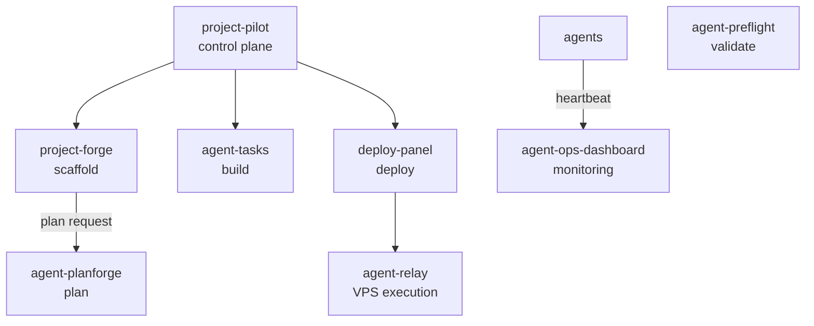

# The Project OS ecosystem

project-pilot is one part of a wider toolchain for building software with AI
agents, covering the full lifecycle from planning through deployment to
monitoring. This document is the system-level view: the design principles
shared across the tools, how they connect, and the integration points between
them.

For project-pilot's own internals (the aggregation model and MCP surface), see
[architecture.md](architecture.md).

## Design principles

These four principles hold across every tool in the toolchain:

1. **Modules, not monolith**: each tool runs independently. Compose only what
   you need.
2. **Human in the loop**: agents propose, humans approve. No fully autonomous
   actions without consent.
3. **Observable by default**: every action is logged, every state is queryable.
4. **Relay pattern**: sensitive operations (deployment, server access) go
   through controlled relay points, never direct agent access.

## How the tools connect

```
Scaffold  ->  Plan  ->  Build  ->  Validate  ->  Deploy  ->  Monitor
```

The diagram below shows which tools project-pilot calls and where the other
lifecycle tools attach.



project-pilot is the control-plane UI. It currently aggregates project-forge,
agent-tasks, and deploy-panel behind a single login; the remaining tools are
composed directly or through those three. project-forge calls agent-planforge
for plans, deploy-panel runs deploys through agent-relay, agents report to
agent-ops-dashboard by heartbeat, and agent-preflight runs on its own.

## Communication patterns

### Task flow

```
Human creates task -> Agent claims -> Agent works -> Agent submits PR -> Human reviews -> Merge -> Deploy
```

### Deploy flow

```
deploy-panel -> agent-relay -> VPS (git pull -> build -> up -> health check)
       ▲                                   │
       └────────────── step events (SSE) ──┘
```

### Monitoring flow

```
Agent heartbeats   -> ops gateway -> agent-ops-dashboard
Claude Code hooks  -> ops gateway    (PostToolUse = busy, Stop = idle)
```

## Integration points

| From | To | Method |
|------|----|--------|
| agent-tasks | GitHub | REST API (PR creation, merge) |
| deploy-panel | agent-relay | HTTP + SSE |
| deploy-panel | CI/CD | REST API v1 + GitHub Action |
| deploy-panel | AI agents | MCP server |
| agent-ops-dashboard | agents | heartbeat REST + SSE |
| Claude Code | agent-tasks | MCP bridge (REST API fallback) |
| Claude Code | deploy-panel | MCP tools |
| Claude Code | agent-ops-dashboard | hooks (PostToolUse) |

## Agent runtime layer

Three tools sit across the whole toolchain rather than at a single lifecycle
stage. They configure and verify the agents themselves:

- **harness**: declarative control plane for an agent harness, one YAML for
  grounding, tools, memory, hooks, and policies.
- **agent-grounding**: runtime verification for agents, claim validation and
  hypothesis tracking.
- **agent-dx**: agent-development tooling, including slop-detector (an
  AI-slop linter for pull requests and committed content) and the
  orchestrator workflow kit.

They are not drawn in the lifecycle diagram above because they apply at every
stage rather than one.

---

*This document consolidates the cross-cutting architecture notes that
previously lived in the now-retired `project-os` umbrella repo.*
