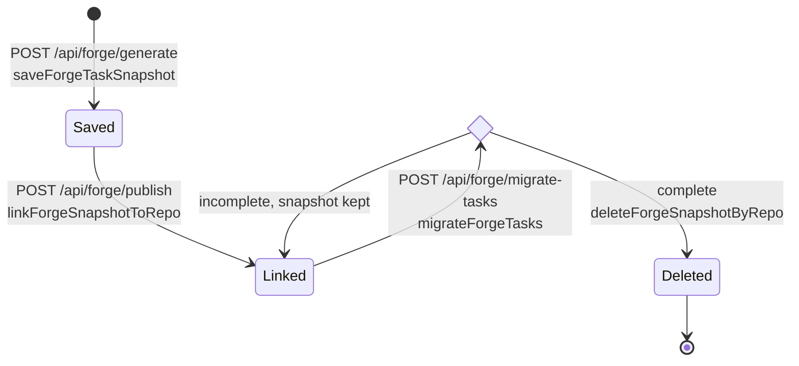

# Forge-to-tasks migration lifecycle

## Responsibility

project-forge forgets a generated plan once the project is published, so
pilot keeps its own copy of the preview's task list in the
`ForgeTaskSnapshot` table and later imports it into agent-tasks
(`backend/prisma/schema.prisma:62-67#"project-forge itself is never modified"`).
This module owns that snapshot and the import. It does not own the tasks once
they are in agent-tasks; from then on agent-tasks is the source of truth.

## Entry points

- `POST /api/forge/generate` saves the snapshot
  (`backend/src/routes/forge.ts:94-101#"failed to snapshot preview tasks"`).
- `POST /api/forge/publish` binds it to the published repo
  (`backend/src/routes/forge.ts:138-144#"failed to link snapshot"`).
- `POST /api/forge/migrate-tasks` takes `repoUrl` and an optional `teamId`
  and runs `migrateForgeTasks`
  (`backend/src/routes/forge.ts:149-160#"migrateForgeTasks(userId, repoUrl, teamId)"`).

All three sit behind `requireAuth` and the CSRF header check (see
[request gating and sessions](request-gating-and-sessions.md)), and every
agent-tasks call goes through `agentTasksRequest` with the user's stored
agent-tasks token
(`backend/src/services/agent-tasks-client.ts:16-21#"getCredential(userId, "`).

## Key files

- `backend/src/services/forge-task-snapshot.ts`, snapshot persistence and
  the repo key.
- `backend/src/services/forge-task-migration.ts`, project resolution, the
  two import paths, and the delete gate.
- `backend/src/routes/forge.ts`, the forge proxy routes that call both.

## Snapshot lifecycle

The diagram shows the states of one `ForgeTaskSnapshot` row and the calls
that move it between them. A migration is incomplete when it returns an
error, when a task failed, or when a skipped task carries `dependsOn` edges
of its own (see the delete gate below).

- **Saved.** `saveForgeTaskSnapshot` upserts on `(userId, sessionId)` with
  `repoUrl` unset (null)
  (`backend/src/services/forge-task-snapshot.ts:88-97#"update: { tasks: data },"`).
  Saving is best-effort: a failure is logged and the generate response is
  returned anyway.
- **Linked.** `linkForgeSnapshotToRepo` writes the repo key into `repoUrl`
  (`backend/src/services/forge-task-snapshot.ts:105-112#"data: { repoUrl: repoKey(repoUrl) },"`),
  also best-effort. `repoKey` reduces a GitHub URL to lower-case
  `owner/repo`, and any other string to its trimmed lower-case form
  (`backend/src/services/forge-task-snapshot.ts:38-40#"repoUrl.trim().toLowerCase()"`),
  so the publish URL and a later URL from the projects list find the same
  row through the `(userId, repoUrl)` index
  (`backend/prisma/schema.prisma:74-75#"@@index([userId, repoUrl])"`).
- **Migrated and deleted.** A migration reads the newest snapshot for the
  repo key (`backend/src/services/forge-task-snapshot.ts:116-122#"orderBy: { createdAt: "`),
  but the delete removes every snapshot of that user with that repo key
  (`backend/src/services/forge-task-snapshot.ts:129-130#"deleteMany({ where: { userId, repoUrl: repoKey(repoUrl) } })"`).
- Nothing expires a snapshot. One that was never linked, or whose migration
  never completed, stays until the user row is deleted
  (`backend/prisma/schema.prisma:80#"onDelete: Cascade"`).

`migrate-tasks` answers 404 `no_snapshot` when no linked snapshot exists for
the repo (`backend/src/services/forge-task-migration.ts:372-377#"no_snapshot"`):
the save or the link failed, the project was published before snapshots
existed, or an earlier complete migration already deleted it. A URL that is
not a GitHub repo URL is rejected first with 400 `invalid_repo`
(`backend/src/services/forge-task-migration.ts:367-369#"invalid_repo"`).

## Project resolution

`migrateForgeTasks` asks `/api/projects/available` for the user's projects.
When agent-tasks answers 400 (a user in several teams), it resolves the team
and asks again scoped to it
(`backend/src/services/forge-task-migration.ts:394-401#"/api/projects/available?teamId="`).
A project whose `githubRepo` matches `owner/repo` case-insensitively is reused
(`backend/src/services/forge-task-migration.ts:409-410#"p.githubRepo?.toLowerCase() === ownerRepoLower"`);
otherwise a new project is created with the repo name, a slug and the
`githubRepo` binding
(`backend/src/services/forge-task-migration.ts:424-431#"githubRepo: ownerRepo,"`).

Team resolution follows the agent-tasks contract:

- an explicit `teamId` must be one of the user's teams, otherwise 400 with
  code `multiple_teams` and the team list
  (`backend/src/services/forge-task-migration.ts:316-320#"Selected team not found"`),
- exactly one team is used silently
  (`backend/src/services/forge-task-migration.ts:324#"teams.length === 1"`),
- no team is 400 `no_team`
  (`backend/src/services/forge-task-migration.ts:325-332#"Create a team in agent-tasks first."`),
- several teams are 409 `multiple_teams` with the list, so the UI can ask
  (`backend/src/services/forge-task-migration.ts:336-343#"teams,"`).

## Two import paths

Every task is mapped to the same import shape: the planforge id becomes
`externalRef`, cut to 255 characters
(`backend/src/services/forge-task-migration.ts:112#"externalRef: task.id.slice(0, 255),"`),
an unknown priority becomes `MEDIUM`
(`backend/src/services/forge-task-migration.ts:98-100#"MEDIUM"`), and the
labels are `source:forge` plus `wave:<wave>` when a wave is set
(`backend/src/services/forge-task-migration.ts:103-113#"labels,"`). The path
is chosen by whether any task carries `dependsOn`: the v1 path runs only
when no snapshot task carries one
(`backend/src/services/forge-task-migration.ts:458-460#"if (!hasDependencies) {"`).
`extractPreviewTasks` passes on whatever `dependsOn` the forge preview
carries, keeping only string ids and dropping an empty list
(`backend/src/services/forge-task-snapshot.ts:70-81#".map(normalizeTaskDependsOn);"`),
and the generate route saves that list as the snapshot
(`backend/src/routes/forge.ts:98#"extractPreviewTasks(result.data.preview)"`).

### v1: flat batch import

Tasks go to `/api/projects/:id/tasks/import` in batches of 200
(`backend/src/services/forge-task-migration.ts:15#"IMPORT_BATCH_SIZE = 200"`),
and the `created`, `skipped` and `failed` counts are summed
(`backend/src/services/forge-task-migration.ts:460-478#"failed += res.data.failed"`).
A failed batch returns its error at once
(`backend/src/services/forge-task-migration.ts:473-474#"return { ok: false, status: res.status, error: res.error };"`);
earlier batches stay imported and the snapshot stays. A re-run imports the
same tasks again and relies on agent-tasks deduplicating on `externalRef`, so
only new tasks are created
(`backend/src/services/forge-task-migration.ts:351-353#"so a second run imports only genuinely new tasks."`).

### v2: dependency-aware import

`topoSortForgeTasks` orders the tasks so every dependency comes first
(`backend/src/services/forge-task-migration.ts:493-495#"sort = topoSortForgeTasks(snapshot);"`).
A `dependsOn` id that is not in the snapshot is dropped with a warning
(`backend/src/services/forge-task-migration.ts:246-250#"(dropped)"`). A cycle
is 409 `cyclic_dependencies` with the cycle
(`backend/src/services/forge-task-migration.ts:498-504#"cycle: err.cycle,"`),
and more than 50 dependencies on one task is 400 `too_many_dependencies`
(`backend/src/services/forge-task-migration.ts:10#"MAX_DEPENDS_ON = 50"`,
`backend/src/services/forge-task-migration.ts:507-513#"taskId: err.taskId,"`).

Tasks are then created one at a time through the single-task route, with
`dependsOn` set to the agent-tasks ids of its own dependencies, which the
topological order created first
(`backend/src/services/forge-task-migration.ts:536-554#"dependsOn: dependsOnUuids"`).
A 409 means the `externalRef` already exists from an earlier run: the
migration looks the task up by `externalRef`
(`backend/src/services/forge-task-migration.ts:565-571#"tasks?externalRef="`)
and accepts the answer only when it is exactly one row with that
`externalRef`; anything else fails the migration with 409
(`backend/src/services/forge-task-migration.ts:586-592#"could not be verified"`).
`dependsOn` is create-time only in agent-tasks, so this run cannot apply the
edges of a skipped task that has dependencies of its own, nor confirm that
the earlier run applied them; the result carries a warning
(`backend/src/services/forge-task-migration.ts:608-612#"dependsOn is create-time only"`).

## The delete gate

The snapshot is deleted only when no task failed and no skipped v2 task
carries `dependsOn` edges of its own
(`backend/src/services/forge-task-migration.ts:626-628#"await deleteForgeSnapshotByRepo(userId, repoUrl);"`).
Any early error return happens before this point, so the snapshot survives
it. In the unconfirmed-edges case the snapshot is kept so those edges are
not lost.
